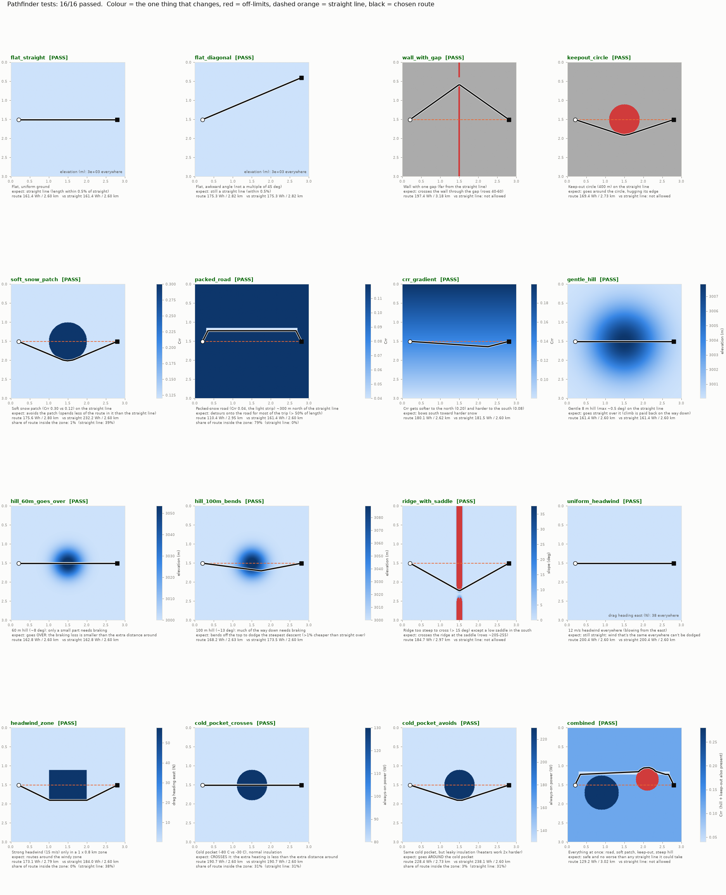
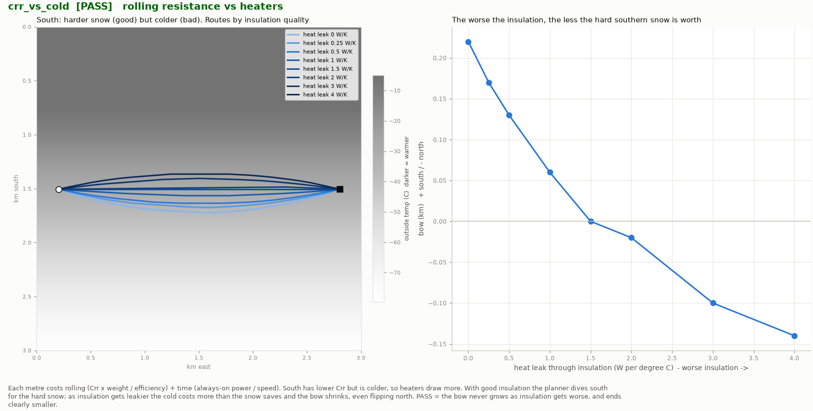
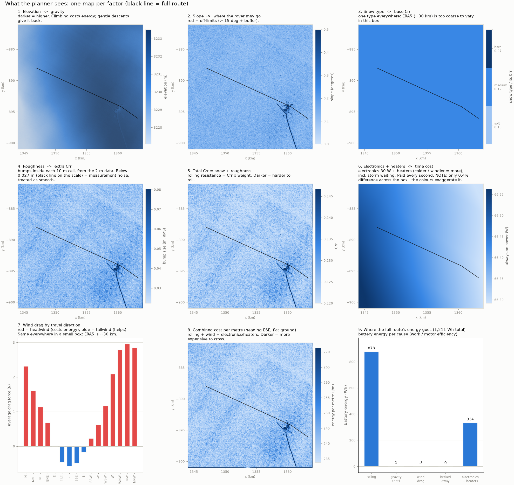

# Antarctic Rover Pathfinder

An energy-optimal route planner for an autonomous rover on the Antarctic plateau.
Given a start and a goal, it finds the route that uses the least battery energy,
taking into account terrain, snow, surface roughness, wind, cold and storms.

The current version works on a 20 x 20 km test box around Concordia Station at
Dome C. **The goal is a global path planner that can plan long rover traverses
anywhere in Antarctica.** This repository is the proof of concept for the energy
model and the search method. See [Where this is going](#where-this-is-going).

> **All rover and snow numbers are placeholders** until the rover exists (mass,
> efficiency, Crr by snow type, and so on). Results show how the planner behaves.
> They are not predictions of real mission energy.

## Current status

Results below come from a full run on 2026-11-09 at commit `3a4aa01`.

| Check | Result |
|---|---|
| Part 1 scenario tests (`test_pathfinder.py`) | **16 / 16 passed** |
| Part 2 trade-off, physics and search tests (`test_pathfinder_pt2.py`) | **12 / 12 passed** |
| Real terrain A* vs brute-force Dijkstra | **Match**: 1,213.4 Wh on both |
| A* search effort on real terrain | 482,899 cells vs 3,869,780 for Dijkstra (8x fewer), 0.92 s |
| Real test route | 18.18 km, 1,206.8 Wh |

## Contents

- [Quick start](#quick-start)
- [Repository layout](#repository-layout)
- [How the planner works](#how-the-planner-works)
- [Why each feature matters](#why-each-feature-matters)
- [Model parameters](#model-parameters)
- [Test details](#test-details)
- [Real terrain results](#real-terrain-results)
- [Bugs found by the tests](#bugs-found-by-the-tests)
- [Known limitations](#known-limitations)
- [Where this is going](#where-this-is-going)

## Quick start

### Environment

```bash
conda create -n rover -c conda-forge python=3.12 numpy scipy rasterio xarray netcdf4 matplotlib numba pyproj cdsapi
conda activate rover
```

Tested with Python 3.12.15, numpy 2.5.4, scipy 1.18.1, rasterio 1.5.2,
xarray 2026.9.0, matplotlib 3.11.2, numba 0.68.0, pyproj 3.8.0, netCDF4 1.7.4.

Always activate the environment, or use `conda run -n rover python ...`. On
Windows, calling the environment's `python.exe` directly can load the wrong BLAS
DLLs and crash inside `numpy.linalg` with exit code `0xc06d007f`.

### Data (not in git)

Put these in the project folder:

| File | Purpose | Required? |
|---|---|---|
| `REMA_10m_elevation.tif` | Planning grid: 2000 x 2000 cells, 10 m, EPSG:3031 | Yes |
| `REMA_2m_elevation.tif` | Roughness: 10000 x 10000 cells, 2 m, EPSG:3031 | Optional |
| `data/era5/era5_domec_YYYY.nc` | Hourly weather, Nov to Jan, 2010 to 2025 | Optional |
| `data/era5/era5_domec_geopotential.nc` | ERA5 ground height, for temperature correction | Optional |

Both REMA files cover x 1,344,000 to 1,364,000 and y -901,000 to -881,000. They
must share the same box corners, because the roughness step refuses grids that do
not line up. If an optional input is missing, that feature switches itself off.

To download ERA5, create a [Copernicus CDS](https://cds.climate.copernicus.eu/)
account and add a `.env` file (git-ignored) with:

```text
CDSAPI_KEY=your-key-here
CDSAPI_URL=https://cds.climate.copernicus.eu/api
```

Then run `python era5_download.py`. Years already downloaded are skipped.

### Run

```bash
python inspect_dem.py REMA_10m_elevation.tif   # sanity-check the elevation data

python pathfinder_v2.py                        # full model + ablation study
python pathfinder_v2.py --no-show --dijkstra   # save plots only, verify A* against Dijkstra
python pathfinder_v2.py --features weather,snow
python pathfinder_v2.py --no-ablate            # only the full model
python pathfinder_v2.py --months 12            # December weather only
python pathfinder_v2.py --start 1347000 -888000 --goal 1363200 -896050
python pathfinder_v2.py --keepout 1350000 -890000 300   # extra no-go circle (x y radius)

python test_pathfinder.py --no-show            # Part 1
python test_pathfinder_pt2.py --no-show        # Part 2
python test_pathfinder.py --only soft_snow_patch,packed_road
```

Coordinates are EPSG:3031 metres (Antarctic Polar Stereographic). Other flags:
`--no-smooth`, `--no-relax`, `--no-keepout`, `--recompute-rough`, `--dem`,
`--era5-dir`. The first run takes longer while numba compiles the search code.

Running the planner or tests overwrites the tracked files in `outputs/`.

## Repository layout

| Path | What it is |
|---|---|
| `pathfinder_v2.py` | **Current planner**: 16-direction A*, smoothing, relaxation, Crr map, ablation, plots |
| `pathfinder.py` | Original v1: 8-direction A*, constant Crr, ERA5 on or off. Kept for reference |
| `test_pathfinder.py` | Part 1: 16 synthetic scenarios, one factor at a time |
| `test_pathfinder_pt2.py` | Part 2: trade-offs, tipping points, hand-calculated physics, hard search cases |
| `era5_download.py` | Downloads ERA5 data for the Dome C box |
| `inspect_dem.py` | Reports DEM statistics and draws elevation and slope maps |
| `outputs/routes.png`, `factors.png`, `closeup.png` | Route map, one map per factor, close-up near the station (`closeup.png` appears after the next planner run) |
| `outputs/route_<variant>.csv` | Smoothed waypoints. `*_grid.csv` holds the raw A* cells |
| `outputs/tests/`, `outputs/tests_pt2/` | One picture per test |

## How the planner works

```text
REMA 10 m ─► slope limit + keep-outs ─► off-limits mask ─┐
REMA 2 m ──► roughness ──────────────┐                   │
ERA5 ──────► snow type ──────────────┴─► Crr map ────────┤
ERA5 ──────► wind drag (16 headings), heaters, storms ───┤
                                                         ▼
                                    A* on a directed 16-neighbour graph
                                                         ▼
                                    Shortcut smoothing (straight lines)
                                                         ▼
                                    Relaxation (bend into smooth curves)
                                                         ▼
                                    Score, ablation, plots, CSV waypoints
```

### Energy model

Every step costs battery energy:

```text
W     = Crr*m*g*L  +  m*g*dh  +  F_drag*L
drive = W / eta_drive         if W > 0
      = W * eta_regen         if W < 0      (eta_regen = 0: brakes waste it)
time  = P_always_on * L / speed
total = drive + time
```

The cost is **directed**: A to B and B to A are separate edges, because hills and
wind depend on the direction of travel.

The components are computed as follows:

```text
Crr(cell)   = Crr_snow(cell) + c_rough * max(0, roughness(cell) - noise_floor)   capped at 0.5
F_drag      = 0.5 * rho * CdA * |V_air| * (V - W_along)
|V_air|     = sqrt((V - W_along)^2 + W_cross^2)
P_heater    = max(0, (k0 + k1 * wind) * (T_inside - T_outside))
P_always_on = (P_elec + P_heater) / (1 - storm_fraction)
```

Drag and heater power are calculated hour by hour from 16 years of ERA5 and then
averaged. Because drag and heat loss are nonlinear, this gives a different and
better answer than applying the formulas to average weather.

### Search

- **A\*** runs on 16 neighbours: 8 compass moves plus 8 knight moves such as 2 east,
  1 south. The extra headings cut the angle error of grid routes. It is compiled
  with numba.
- **The heuristic** is the best-case remaining cost: straight-line distance times
  minimum Crr, drag and time cost, plus any unavoidable climb. It never
  overestimates, so A* returns the true best route on the grid.
- **Move checks** reject any edge that is too steep, and stop diagonal and knight
  moves slipping between off-limits cells.

### Smoothing and relaxation

Grid routes can only point in 16 directions, so two stages refine them on the real
terrain:

1. **Shortcut smoothing** replaces a stretch of route with a straight line if the
   line is allowed and costs no more.
2. **Relaxation** treats the route as beads on a string and nudges each bead
   whenever that saves energy, from coarse spacing (800 m) to fine (100 m).

Both stages only accept improvements. Every grid cell a straight line passes
through is checked against the off-limits mask.

The optimality guarantee applies to the A* grid result. Smoothing and relaxation
are local improvements, so the final route is very good but not proven optimal.

### Ablation study

To find out whether a feature matters, the planner plans again with that feature
turned off, then scores every route with the **full** model. The extra energy is
that feature's **regret**: what you would lose by ignoring it.

| Variant | What changes |
|---|---|
| `no_weather` | Calm air, one outside temperature (-30 C) |
| `no_snow` | Every cell gets the area's average snow Crr |
| `no_rough` | Every cell gets the area's average roughness |
| `baseline` | All three off |

## Why each feature matters

On the plateau the rover's energy goes to two main things: rolling resistance
(72% of the test route, as drive energy) and keeping itself alive (28%). Most
features below act on one of those two.

### Crr (coefficient of rolling resistance)

Rolling resistance force is `Crr x weight`. Snow has a very high Crr compared with
pavement, so this is usually the largest energy cost. With the placeholder values,
flat ground at Crr 0.12 costs 168 J/m to roll and 55 J/m for electronics and
heating. Changing Crr changes the cost of every metre, so the planner treats it as
a map. Crr also sets the slope where the rover starts rolling by itself
(`tan(slope) = Crr`), which decides how much descent energy is lost to braking.

### Snow type

Snow type is the main driver of Crr. Soft fresh snow lets wheels sink. Wind-packed
snow supports them. A route that detours onto harder snow can be cheaper even
though it is longer. `packed_road` used 32% less energy than the straight line.

The model classifies each cell from ERA5:

| Class | Rule | Crr |
|---|---|---|
| Hard (wind-packed) | Mean 10 m wind >= 6 m/s (takes priority) | 0.07 |
| Soft | Snowfall >= 5 mm water per 30 days | 0.18 |
| Medium | Otherwise | 0.12 |

### Surface roughness

Bumps cost energy beyond what smooth-snow Crr captures, and a slope or elevation
map hides them. The planner measures roughness from the 2 m REMA file:

1. Smooth the surface over a 50 m window, which removes the overall tilt.
2. Subtract that from the surface and take the RMS of what is left.
3. Average it into each 10 m cell.
4. Treat the smoothest 10% as measurement noise (0.027 m in the test box), and add
   0.5 Crr per metre of roughness above that. Values over 3 m are treated as data
   errors.

This is the only feature that changed the real test route, with 2.56% regret.

### Elevation and gravity

Climbing costs `m*g*dh / eta`. On a gentle descent, the slope offsets rolling
resistance, so height is effectively paid back. On a steep descent, gravity exceeds
rolling resistance and the surplus is lost to the brakes. So a hill's cost depends
on its shape as well as its height. At Crr 0.12 braking begins at about 6.8 degrees.
The `hill_60m_goes_over` and `hill_100m_bends` tests cover the two sides of this.

### Slope limit

Slopes above 15 degrees are off-limits, plus a one-cell safety buffer, for traction
and stability. This is a hard constraint rather than a cost. It protects the rover
from terrain that no amount of energy makes safe, and on this box it also marks
buildings and snow piles around the station.

### Keep-out zones

Some ground is forbidden for reasons a terrain map cannot show, such as stations,
fuel depots, science areas and known hazards. Concordia Station has a 500 m no-go
circle. The default straight line passes directly through it.

### Wind drag

The rover drives slowly, so still-air drag is tiny (about 0.2 N). Wind is what makes
drag matter: a 12 m/s headwind produces about 38 N, a third of the rolling force.
Wind direction also makes route cost depend on heading, so the planner keeps a
separate drag layer for each of 16 directions. Using the full airflow, crosswind
included, stops the route zig-zagging to exploit a free crosswind. Drag is averaged
only over hours when the rover would be driving.

### Temperature and heaters

Electronics and batteries must be kept warm (20 C target here). Heater power grows
with the temperature difference and with wind chill. Because that power is paid
every second, it turns time into energy. `crr_vs_cold` shows it can outweigh the
benefit of better snow.

A lapse rate of 6.5 C per km corrects ERA5 temperature to the local elevation,
since ERA5 terrain is much coarser than the planning grid.

### Storms

Above 15 m/s of 10 m wind, the rover is assumed to park and wait. Heaters and
electronics keep running while parked, so storms act as a multiplier on time cost,
`1 / (1 - storm_fraction)`. Storm hours were 0% at Dome C in Nov to Jan, but this
term becomes important in windier parts of the continent.

### Air density

Thin, cold air changes drag. Density is calculated hourly from ERA5 surface pressure
and temperature (`rho = p / (R*T)`). Dome C sits above 3,200 m, so ignoring this
would use the wrong drag force.

### Speed and insulation

These are not map features, but they set how the planner trades distance against
terrain. Time cost per metre is `power / speed`, so a slow or poorly insulated
rover pays more for every extra metre and favours shorter routes. A fast or
well-insulated one can afford a longer detour to better snow. `crr_vs_speed` and
`crr_vs_cold` measure this.

### Directed search and A* vs Dijkstra

Directed edges are what make wind and slopes work. `wind_both_ways` shows the same
wind zone is avoided in one direction and used in the other. Dijkstra is kept
solely as a brute-force check that the A* heuristic is correct.

## Model parameters

Defined in `PARAMS` at the top of `pathfinder_v2.py`. **All are placeholders.**

| Group | Parameter | Value |
|---|---|---|
| Rover | Mass | 100 kg |
| | Drive efficiency | 0.70 |
| | Regenerative braking | 0 (none) |
| | CdA | 0.5 m^2 |
| | Speed | 1.0 m/s |
| | Electronics | 30 W |
| Thermal | Inside temperature | 20 C |
| | Heat leak, calm air | 0.5 W/K |
| | Extra heat leak with wind | 0.05 W/K per m/s |
| Terrain | Max slope | 15 degrees |
| | Buffer around steep cells | 1 cell |
| | Keep-out | Concordia, 500 m radius at (1360008, -894378) |
| Snow | Crr soft / medium / hard | 0.18 / 0.12 / 0.07 |
| | Hard-snow wind threshold | 6 m/s mean at 10 m |
| | Soft-snow threshold | 5 mm water per 30 days |
| Roughness | Window | 50 m |
| | Noise floor | Automatic, smoothest 10% |
| | Extra Crr | 0.5 per metre above the floor |
| | Ignored above / total Crr cap | 3 m / 0.5 |
| Weather | 10 m wind to rover height | x 0.8 |
| | Storm limit | 15 m/s at 10 m |
| | Lapse rate | 6.5 C per km |
| | Weather-off defaults | -30 C, 65,000 Pa |
| Smoothing | Shortcut lookahead | 60 cells |
| | Relaxation spacing | 800, 400, 200, 100 m |

## Test details

All synthetic tests use a 3 x 3 km world of 10 m cells (300 x 300), and run the
same planning code as the real pipeline. The default world is flat at 3,000 m, Crr
0.12, -30 C, calm, air density 0.9 kg/m^3. The default trip runs 2.6 km due east.

### Part 1: does the planner react correctly?

Each scenario changes one thing. Every scenario must pass three checks:

1. **Safe**: the route never enters an off-limits cell.
2. **Not worse**: it costs no more than the straight line (+0.1% tolerance), when
   the straight line is allowed.
3. **Expected**: the scenario's own condition below.

"Line Wh" is the straight route's energy, or "blocked" if that line is not allowed.

| Scenario | Setup | Pass condition | Route Wh | Line Wh | km |
|---|---|---|---:|---:|---:|
| `flat_straight` | Flat and uniform | Length within 0.5% of straight | 161.4 | 161.4 | 2.60 |
| `flat_diagonal` | Awkward heading, not a multiple of 45 degrees | Length within 0.5% of straight | 175.3 | 175.3 | 2.82 |
| `wall_with_gap` | Wall with one gap, far off the line | Crosses through the gap | 197.4 | blocked | 3.18 |
| `keepout_circle` | 400 m no-go circle on the line | Safe and goes around | 169.4 | blocked | 2.73 |
| `soft_snow_patch` | Crr 0.30 patch on the line | Under half the line's time in the patch | 173.9 | 232.2 | 2.80 |
| `packed_road` | Crr 0.04 road 300 m north | Over 50% of route on the road | 110.1 | 161.4 | 2.94 |
| `crr_gradient` | Crr 0.20 north to 0.08 south | Bows south | 178.8 | 181.5 | 2.64 |
| `gentle_hill` | 8 m hill, about 0.5 degrees | Goes straight over | 161.4 | 161.4 | 2.60 |
| `hill_60m_goes_over` | 60 m hill, about 8 degrees | Goes over: braking loss is less than the detour | 162.1 | 162.8 | 2.61 |
| `hill_100m_bends` | 100 m hill, about 13 degrees | Bends away, over 1% cheaper | 164.7 | 173.5 | 2.65 |
| `ridge_with_saddle` | Ridge over 15 degrees with one low saddle | Crosses at the saddle | 184.7 | blocked | 2.97 |
| `uniform_headwind` | 12 m/s headwind everywhere | Stays straight: uniform wind cannot be dodged | 200.8 | 200.8 | 2.60 |
| `headwind_zone` | 15 m/s headwind in a 1 x 0.8 km zone | Under half the line's time in the zone | 172.9 | 184.2 | 2.78 |
| `cold_pocket_crosses` | -80 C pocket, 1 W/K insulation | Crosses it: heating is cheaper than the detour | 190.4 | 190.7 | 2.60 |
| `cold_pocket_avoids` | Same pocket, 2 W/K insulation | Under half the line's time in the pocket | 226.3 | 238.1 | 2.73 |
| `combined` | Road, soft patch, keep-out and hill together | Safe, and not worse than the line | 128.8 | blocked | 3.02 |

The paired scenarios, hill 60/100 and cold crosses/avoids, matter most. They show
the planner avoids an obstacle only when avoiding it is actually cheaper.



### Part 2: trade-offs, tipping points, physics and hard search

**Trade-offs: how far is a detour worth it?**

| Test | What it does | Pass condition | Result |
|---|---|---|---|
| `crr_depth` | Scores 33 hand-made bows on a Crr gradient, against the planner's route | Best depth is inside the range, planner within 0.2% of the best bow | Best bow 0.20 km / 178.9 Wh. Planner 0.19 km / 178.8 Wh |
| `crr_vs_cold` | South has harder snow but is colder. Sweeps heat leak from 0 to 4 W/K | Bow never grows as insulation worsens and ends clearly smaller | See below |
| `crr_vs_speed` | Same gradient, speeds from 0.25 to 4 m/s | Bow never shrinks as speed rises and grows overall | See below |

| Heat leak (W/K) | 0 | 0.25 | 0.5 | 1 | 1.5 | 2 | 3 | 4 |
|---|---:|---:|---:|---:|---:|---:|---:|---:|
| Bow (km, + south, - north) | +0.22 | +0.17 | +0.13 | +0.06 | 0.00 | -0.02 | -0.10 | -0.14 |

| Speed (m/s) | 0.25 | 0.5 | 1 | 2 | 4 |
|---|---:|---:|---:|---:|---:|
| Bow south (km) | 0.11 | 0.14 | 0.19 | 0.22 | 0.23 |

The heat leak sweep shows the planner balancing two costs: with leaky insulation the
cold outweighs the better snow and the route flips north.



**Tipping points: when does the planner change its mind?**

| Test | What it does | Pass condition | Result |
|---|---|---|---|
| `soft_patch_tipping` | Patch Crr swept 0.12 to 0.40 | Time in patch never rises, starts straight through, ends fully around | Tips at Crr about 0.16 |
| `road_offset_tipping` | Crr 0.04 road moved 0.1 to 1.4 km away | Uses a nearby road, and use never rises with distance | See below |

| Road distance (km) | 0.1 | 0.2 | 0.35 | 0.5 | 0.7 | 0.9 | 1.1 | 1.4 |
|---|---:|---:|---:|---:|---:|---:|---:|---:|
| Route on road | 90% | 85% | 75% | 67% | 56% | 0% | 0% | 0% |

**Physics: numbers checked by hand.**

| Test | Check | Planner | Hand calculation | Tolerance |
|---|---|---:|---:|---:|
| `flat_exact` | `(Crr*m*g + drag)/eta + P/v`, times distance | 161.41 Wh | 161.41 Wh | 0.5% |
| `ramp_both_ways` | Uphill minus downhill = `2*m*g*dh/eta` | 33.851 Wh | 33.851 Wh | 1% |

`wind_both_ways` drives through the same 15 m/s wind zone in both directions. Driving
east into the headwind, the route spends 0% of its length inside the zone (must be
under 30%). Driving west with the tailwind, it spends 46% inside, as much as the
straight line would.

**Hard search: A\* must match brute-force Dijkstra exactly.** The smoothed route must
also stay out of off-limits cells.

| Test | Setup | A* Wh | Dijkstra Wh | A* cells | Dijkstra cells |
|---|---|---:|---:|---:|---:|
| `maze` | Five walls, gaps alternating top and bottom | 736.580 | 736.580 | 67,287 | 76,057 |
| `crevasse_field` | Random obstacles cover 30% of the ground | 202.485 | 202.485 | 17,470 | 58,747 |
| `dead_end_trap` | U-shaped trap facing the start | 226.662 | 226.662 | 51,568 | 87,879 |
| `random_worlds` | 12 worlds mixing all factors, random start and goal | Matched | Matched | 12 / 12 | 12 / 12 |

## Real terrain results

Dome C test box, Concordia Station area. Straight-line distance is 18.09 km, from
(1347000, -888000) to (1363200, -896050), passing directly through the station.

| Terrain and weather inputs | Value |
|---|---|
| Grid | 2000 x 2000 cells at 10 m, 4 million cells, no holes |
| Elevation | 3,226.4 to 3,243.5 m |
| Slope | Median 0.122 degrees, max 23.01 degrees |
| Off-limits | 0.196% (43 steep cells, 7,853 keep-out cells) |
| ERA5 | 16 seasons, 35,328 hours, Nov to Jan |
| Mean outside temperature / heater power | -34.0 C / 36.3 W |
| Mean 10 m wind / storm hours | 4.3 m/s / 0.0% |
| Snow class | 100% medium |
| Roughness p10 / median / p90 / p99 | 0.027 / 0.034 / 0.044 / 0.080 m |

Full-model route:

| Item | Value |
|---|---:|
| Length | 18.18 km (129 waypoints) |
| Rolling work | 612.6 Wh |
| Net gravity work | 0.8 Wh |
| Drag work | -3.1 Wh (net tailwind) |
| Braked away | 0.0 Wh |
| Drive battery energy | 872.0 Wh |
| Electronics and heaters | 334.9 Wh |
| **Total** | **1,206.8 Wh** |
| Closest approach to off-limits ground | 10 m |

Ablation, every route scored with the full model:

| Variant | Wh | Regret Wh | Regret % | km |
|---|---:|---:|---:|---:|
| `full` | 1,206.8 | 0.0 | 0.00% | 18.18 |
| `no_weather` | 1,206.3 | -0.5 | -0.05% | 18.19 |
| `no_snow` | 1,206.8 | 0.0 | 0.00% | 18.18 |
| `no_rough` | 1,237.7 | 30.9 | 2.56% | 18.12 |
| `baseline` | 1,237.8 | 30.9 | 2.56% | 18.12 |

Regret within about 0.1% of zero is noise from smoothing.

**How to read this:** weather and snow have no effect here because ERA5 points are
roughly 7 to 28 km apart, which is about the size of the whole box. Weather and snow
are nearly the same everywhere in it, and a uniform cost cannot change a route. This
does not mean those features are unimportant. The synthetic tests show they do
change routes when they vary, and they should matter far more over long distances.



*This image was generated before the latest relaxation and smoothing fixes, so it
shows 1,211 Wh rather than the current 1,207 Wh. The committed `route_*.csv` and
`routes.png` are from the same earlier run. Re-run `pathfinder_v2.py` to refresh
them.*

## Bugs found by the tests

| # | Problem | Fix | Caught by |
|---|---|---|---|
| 1 | Routes could clip the corner of a forbidden cell, since lines were only sampled every 5 m | `segment_clear` checks every cell the line touches, and diagonal moves cannot pass between touching off-limits cells | `maze`, `crevasse_field` |
| 2 | Routes could not follow curves, and a hand-drawn curve beat the planner by 1.2 Wh | Added `relax_path` | `crr_depth` |
| 3 | Routes zig-zagged in a steady headwind, because crosswind was free and drag was blended linearly between headings | Full airflow in drag, plus a smooth Fourier fit across all 16 headings | `uniform_headwind` |

## Known limitations

**Rover model**

- Every rover parameter is a placeholder, and Crr values have not been measured.
- **No turn radius.** The full route has 129 waypoints and no curvature limit, so it
  may not be drivable as planned.
- Speed is constant. There is no traction, wheel sinkage or slip model.
- The slope limit is independent of direction, with no side-slope or tip-over model.
- Clearance is only the one-cell buffer. The route passes within 10 m of off-limits
  ground, and rover width is not modelled.
- Energy is minimised, but there is no battery capacity, recharging, solar input or
  mission time limit.

**Data**

- ERA5 is too coarse to separate conditions inside the 20 km test box.
- Snow type is a rule of thumb on long-term climate averages. "Recent snowfall" is
  really the average snowfall rate scaled to 30 days, not recent real snowfall.
- REMA elevation cannot directly see features smaller than a few metres, such as
  many sastrugi.
- There is no real crevasse data. `crevasse_field` uses synthetic obstacles.
- The ERA5 download, file names and default keep-out are specific to Dome C.

**Planning**

- Weather is a seasonal average, so routes do not react to a forecast or the time of
  day.
- Grid cells are treated as exactly 10 m. EPSG:3031 is only true to scale at 71 S:
  this is roughly a 1% distance error at Dome C and up to about 3% near the pole.

**Tests**

- The synthetic test helper `drag_from_wind` uses head and tail wind only, while the
  real ERA5 pipeline also includes crosswind. The tests therefore do not exercise
  the crosswind part of the drag formula.
- `pathfinder.py` (v1) and `era5_download.py` were not re-run for the results here.

## Where this is going

**The target is a global path planner for a rover anywhere in Antarctica:** give it
two points on the continent and receive a safe, drivable, energy-optimal route. The
items below are the work this prototype points to. Apart from turn radius, which is
already planned, they are proposals to discuss.

1. **Real rover numbers.** Replace placeholders with measured mass, efficiency and
   thermal data, then sweep the remaining uncertainty.
2. **Turn radius and drivable routes.** Add a curvature limit so output can be
   followed by the real vehicle.
3. **Scale.** The current approach does not extend directly to the continent. At
   10 m, Antarctica is about 140 billion cells, and the drag layers alone would need
   about 9 TB. Even a 1,000 x 100 km corridor would need about 64 GB for drag. The
   natural design is hierarchical: plan coarsely across the continent, then refine
   at 10 m inside a corridor around that route.
4. **Continental data.** Generalise ERA5 and REMA handling beyond Dome C and tile the
   inputs. Correct for polar stereographic scale.
5. **Better surface data.** Find snow and surface observations with finer resolution
   than ERA5, validated against field Crr measurements. This is where snow type
   should start to change routes.
6. **Hazards.** Add real crevasse maps, stations, depots and protected areas.
7. **Time and energy budget.** Move to time-dependent weather and forecasts, and add
   battery capacity, charging and mission duration limits.
8. **Safety and validation.** Add direction-aware slope limits and rover-width
   clearance, then compare predicted energy against field data.
